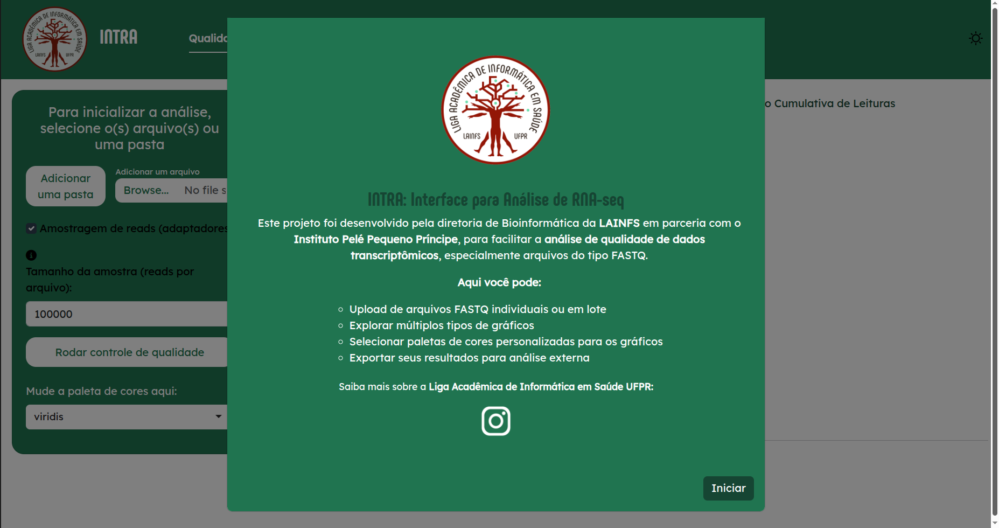

# INTRA — INTerface for RNA-seq Analysis
 

 
## Sobre a ferramenta
 
A INTRA é um aplicativo [Shiny](https://shiny.posit.co/) de código aberto, em desenvolvimento, que reúne em uma interface gráfica as etapas iniciais do pré-processamento de dados de RNA-seq:
 
- **Análise de qualidade** de arquivos FASTQ (single-end e paired-end), com [ShortRead](https://bioconductor.org/packages/ShortRead/).
- **Trimagem**, com remoção de adaptadores e de bases de baixa qualidade, usando o [Trimmomatic](http://www.usadellab.org/cms/?page=trimmomatic).
A interface está em português. Os gráficos são personalizáveis e podem ser baixados.
 
> **Estágio atual:** o projeto está em desenvolvimento. A ferramenta ainda não passou por validação sistemática de desempenho, usabilidade ou compatibilidade entre sistemas operacionais.
 
---
 
## Requisitos
 
| Componente | Versão testada | Observação |
|---|---|---|
| R | 4.6.1 (2026-06-24) | |
| RStudio | 2026.9.0.174 | Usado para executar o app |
| Shiny | 1.14.0 | |
| ShortRead | 1.70.0 | Bioconductor |
| Java (JRE/JDK) | OpenJDK 25.0.4.1 | Necessário para o Trimmomatic. Precisa estar no `PATH` (teste com `java -version`). |
| Trimmomatic | 0.39 | Incluído no repositório (ver abaixo). |
| Sistemas operacionais | Ubuntu 26.04.1 LTS (x86_64) | Outros sistemas e versões não foram testados. |
 
---
 
## Como utilizar
 
### 1. Baixe o repositório
 
```bash
git clone https://github.com/lainfs-ufpr/intra.git
```
 
Ou use o botão **Code → Download ZIP** e extraia a pasta.
 
### 2. Instale as dependências
 
Instale o [R](https://cran.r-project.org/), o [RStudio](https://posit.co/download/rstudio-desktop/) e o [Java](https://adoptium.net/). Depois, no RStudio, abra o projeto (`projeto-bioinformatica.Rproj`) e rode:
 
```r
source("dependencies.R")
```
 
O script instala os pacotes do CRAN e o ShortRead (Bioconductor). Em Linux/Ubuntu, pode ser necessário instalar bibliotecas do sistema antes (veja [Possíveis dificuldades](#possíveis-dificuldades)).
 
### 3. Trimmomatic
 
O Trimmomatic 0.39 (`trimmomatic-0.39.jar`) já acompanha este repositório em `[data/trimmomatic-0.39.jar]`; não é preciso baixá-lo. Na aba de trimagem, o app pede que você selecione o arquivo `.jar` pela interface: escolha esse arquivo. Você também pode usar outro `.jar` do Trimmomatic, baixado em <http://www.usadellab.org/cms/?page=trimmomatic>.
 
O Trimmomatic é um software de terceiros, distribuído sob a licença própria dele (veja a seção [Licença](#licença)). Cite o artigo correspondente ao usá-lo.
 
### 4. Execute o aplicativo
 
No RStudio, abra o arquivo `app.R` e clique em **Run App**. Aguarde a interface carregar.
 


 
### 5. Fluxo básico
 
1. **Qualidade:** selecione os arquivos FASTQ e execute a análise.
2. **Trimagem:** selecione o `.jar` do Trimmomatic, escolha o modo (single-end ou paired-end), o arquivo de adaptadores e os parâmetros, e execute.
3. Baixe os gráficos e os arquivos resultantes.
---
 
## Possíveis dificuldades
 
### Java não encontrado
 
Se a trimagem falhar, verifique no terminal se `java -version` funciona. Se não funcionar, instale o Java e reinicie o RStudio.
 
### Sistema operacional Linux/Ubuntu
 
O projeto usa os pacotes **ShortRead** e **tidyverse**. No Ubuntu, a instalação pode falhar por falta de bibliotecas do sistema necessárias para compilar os pacotes. Nesse caso, rode no terminal:
 
```bash
sudo apt update
sudo apt install -y \
  build-essential \
  gfortran \
  libblas-dev \
  liblapack-dev \
  libcurl4-openssl-dev \
  libssl-dev \
  libxml2-dev \
  libpng-dev \
  libjpeg-dev \
  libtiff5-dev \
  zlib1g-dev \
  libbz2-dev \
  liblzma-dev \
  libfribidi-dev \
  libfontconfig1-dev \
  libharfbuzz-dev \
  libfreetype6-dev
```
 
Depois, reinicie o RStudio e rode `source("dependencies.R")` novamente.
 
---
 
## Limitações conhecidas
 
- Exige a instalação do Java; o `.jar` do Trimmomatic precisa ser selecionado pela interface.
- Depende dos recursos computacionais da máquina local.
- O fluxo se limita às ferramentas integradas (ShortRead e Trimmomatic).
- Compatibilidade entre sistemas operacionais, desempenho e usabilidade ainda não foram avaliados de forma sistemática.

## Atualizações futuras
 
- Nova etapa de análise de qualidade após a trimagem.
---
 
## Licença
 
Este projeto é distribuído sob a licença **GNU Affero General Public License v3.0 (AGPL-3.0)** — veja o arquivo [LICENSE](LICENSE).
 
Você pode usar, estudar, modificar e redistribuir a INTRA. Se você distribuir uma versão modificada, ou oferecê-la como serviço acessível por rede (por exemplo, hospedando o app para outras pessoas), deve disponibilizar o código-fonte correspondente sob a mesma licença.
 
O Trimmomatic, incluído neste repositório, e os demais pacotes utilizados têm licenças próprias, que devem ser consultadas por quem os utiliza. A AGPL-3.0 se aplica ao código da INTRA.
 
## Como citar
 
--
 
## Autoria
 
Projeto desenvolvido pela diretoria de Bioinformática da Liga Acadêmica de Informática em Saúde (LAINFS) da Universidade Federal do Paraná (UFPR), em parceria com o Instituto de Pesquisa Pelé Pequeno Príncipe.
